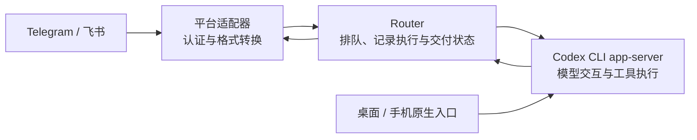

# MK · AI4Research — Router：让消息找到同一个长期助手

从聊天软件联系 AI 助手时，怎样让消息进入原来的对话，而不是每次重新开始？如果发送后断线，应该重发，还是先确认它已经执行了？如果桌面端也在使用这个助手，消息又该怎样协调？

**Router 处理这些消息与会话管理问题。** 它围绕 Codex CLI 的 app-server 建立一层持久化控制：记录消息发给谁、执行到哪里、回复是否送达，并在故障后保留可核查的状态。模型回答和工具执行仍由 Codex 后端负责。

本仓库选取了真实实现中的 **18 个 Go 源码与测试文件**，配有机制说明和离线测试入口。它展示可检查的工程方法，**不包含可直接部署的完整聊天机器人或助手服务**。

## 一条消息会经过什么

以消息平台入口为例：

1. 平台适配器确认消息来源，把平台特有格式转换成统一输入。
2. Router 找到指定助手的长期主会话，识别重复消息，并安排处理顺序。
3. 通过 Codex 接口提交任务，记录任务与回复的对应关系。
4. 把待发送回复写入持久记录，再交付消息平台。

这让“助手是否执行了任务”和“用户是否收到回复”成为两个分别可查的问题。遇到结果不确定的操作时，系统需要先核对状态，不能把所有失败都当作可以安全重试。



原生入口直接使用 Codex，不经过消息队列。Router 根据观察到的运行活动协调消息任务；这不构成对所有入口的统一事务或“绝不重复”的保证。

## 自建机制与 Codex 适配层

| 部分 | 本项目做什么 | 本仓库的展示范围 |
| --- | --- | --- |
| **消息与状态机制** | 输入去重、按顺序排队、保存执行与待投递回复、处理不确定结果 | 核心实现及合成测试 |
| **长期会话管理** | 记录哪一个会话是主会话，以及更换前后各自对应的时间区间 | 状态存储与历史接口；完整管理工具未收录 |
| **Codex 适配** | 按会话和回合标识匹配通知，把外部会话活动转为队列协调信号 | 关联与协调逻辑；真实在线客户端未收录 |
| **消息平台适配** | 对接平台认证、接收与发送，并转换消息格式 | 统一输入部分；在线传输未收录 |
| **助手执行能力** | 模型交互、工具执行、原生会话与沙盒 | 由上游 Codex CLI app-server 提供 |

消息状态机、去重和故障处理思路可以用于其他助手后端；**当前实现并不是后端无关的通用路由器**。迁移时需要替换会话与通知适配，核对新后端的提交、取消和恢复语义，并处理平台、存储与操作系统依赖。所选代码面向 Unix/macOS，不能视为已验证的跨平台包。

## 按兴趣继续阅读

| 想了解什么 | 入口 |
| --- | --- |
| 整体分工与运行边界 | [架构与职责](docs/ARCHITECTURE.md) |
| 为什么断线后不能直接重发？如何协调桌面端活动？ | [机制与取舍](docs/MECHANISMS.md) |
| 消息处理代码 | [router.go](internal/router/router.go) |
| 队列、任务和回复怎样保存？ | [SQLite 状态存储](internal/store/store.go) |
| 主会话更换后怎样保留历史？ | [main_history.go](internal/store/main_history.go) |
| 选取了哪些真实文件？ | [来源说明](provenance/README.md) |

技术文档中的 `main` 指长期主会话；`outbox` 指已保存、等待投递的回复记录。更多细节放在上述文档中，理解本项目的用途无需先阅读代码。

## 运行隔离测试

需要 Go 1.26、C 工具链和系统 SQLite；Python 3 用于管理一次性测试环境。本版在 macOS 上验证，不下载 Go 模块，不需要模型或平台凭证。

```sh
python3 scripts/test.py
```

测试使用临时数据库、缓存和本地 Unix socket，结束后清理自身临时目录，不启动生产服务。沙盒可能限制 socket 测试；已验证范围和相应运行方式见[验证记录](docs/VALIDATION.md)。

## 与整体系统的关系

Router 来自一套围绕 Codex 建立的个人多助手系统，与以下独立展示仓库配套：

- [MK_AI4Research-AgentSystem-Showcase](https://github.com/Mark-Ke-MA/MK_AI4Research-AgentSystem-Showcase)：人格规则、工作区、权限与日常维护的总览。
- [MK_AI4Research-MQElite-Showcase](https://github.com/Mark-Ke-MA/MK_AI4Research-MQElite-Showcase)：保存并检索对话记录；它借助 Router 的主会话历史判断应该读取哪些对话。

Router 保存的是消息处理状态和会话身份历史，长期对话档案由 MQElite 负责。本仓库可单独阅读和运行所选测试。

## 来源与许可

这是 **2026-10-11** 整理的工程展示快照。项目采用人类主导、AI 辅助的开发方式：人类负责需求、取舍、审阅和验收，AI 协助实现；源码不代表全部由人类逐行手写。

本仓库未授予代码复用许可证，不包含第三方实现的 vendor 副本。公开材料供检查设计与实现，不承诺与私人运行系统持续同步。
