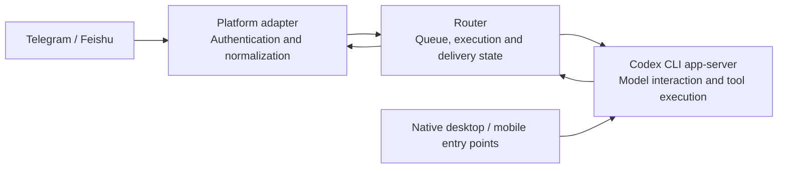

# MK · AI4Research — Router: Reaching the Same Long-Term Assistant

[中文](README.md) | English

When you contact an AI assistant through a messaging app, how does your message reach the existing conversation instead of starting over? If the connection drops after submission, should you resend the request or first determine whether it has already run? How should messages be coordinated when the same assistant is also in use on the desktop?

**Router handles these message and session-management problems.** It adds a persistent control layer around the Codex CLI app-server: recording who a message is for, how far execution has progressed, and whether the reply has been delivered, while preserving inspectable state after failures. Model responses and tool execution remain the responsibility of the Codex backend.

This repository selects **18 Go source and test files** from the actual implementation, with mechanism documentation and an offline test entry point. It presents inspectable engineering methods; **it does not contain a complete, directly deployable chatbot or assistant service**.

## What Happens to a Message

For a messaging-platform entry point:

1. The platform adapter authenticates the message source and converts platform-specific formats into a common input.
2. Router locates the designated assistant's long-term main session, identifies duplicate messages, and schedules processing in order.
3. It submits the task through the Codex interface and records the association between the task and its reply.
4. It persists the pending reply before delivering it to the messaging platform.

This makes “Did the assistant execute the task?” and “Did the user receive the reply?” two separately inspectable questions. Operations with uncertain outcomes require state reconciliation first; not every failure is safe to retry.



Native entry points use Codex directly, bypassing the message queue. Router coordinates message tasks based on observed runtime activity; this does not provide a single transaction across all entry points or a guarantee that duplication can never occur.

## Custom Mechanisms and the Codex Adaptation Layer

| Area | What this project does | What this repository presents |
| --- | --- | --- |
| **Message and state mechanisms** | Input deduplication, ordered queuing, persistence of execution and pending replies, handling uncertain outcomes | Core implementation and synthetic tests |
| **Long-term session management** | Records which session is main and the time intervals corresponding to sessions before and after replacement | State storage and history interface; complete management tools are not included |
| **Codex adaptation** | Correlates notifications by session and turn identifiers; converts external session activity into queue-coordination signals | Correlation and coordination logic; the real online client is not included |
| **Messaging-platform adaptation** | Integrates platform authentication, receiving and sending, and message-format conversion | Common-input normalization; online transport is not included |
| **Assistant execution capabilities** | Model interaction, tool execution, native sessions, and sandboxing | Provided by the upstream Codex CLI app-server |

The message state machine, deduplication, and failure-handling ideas can be applied to other assistant backends; **the current implementation is not a backend-independent general-purpose router**. Porting requires replacing session and notification adapters, checking the new backend's submission, cancellation, and recovery semantics, and addressing platform, storage, and operating-system dependencies. The selected code targets Unix/macOS and should not be treated as a verified cross-platform package.

## Where to Read Next

| Interest | Entry point |
| --- | --- |
| Overall responsibilities and runtime boundaries | [Architecture and responsibilities](docs_en/ARCHITECTURE.md) |
| Why not resend immediately after a disconnect? How is desktop activity coordinated? | [Mechanisms and trade-offs](docs_en/MECHANISMS.md) |
| Message-processing code | [router.go](internal/router/router.go) |
| How are queues, tasks, and replies stored? | [SQLite state storage](internal/store/store.go) |
| How is history preserved when the main session changes? | [main_history.go](internal/store/main_history.go) |
| Which real files were selected? | [Provenance](provenance/README_en.md) |

In the technical documentation, `main` means the long-term main session; `outbox` means persisted replies awaiting delivery. Further details are in the documents above; understanding the project's purpose does not require reading the code first.

## Run the Isolated Tests

Requirements: Go 1.26, a C toolchain, and system SQLite; Python 3 manages the disposable test environment. This version was validated on macOS. It does not download Go modules or require model or platform credentials.

```sh
python3 scripts/test.py
```

The tests use temporary databases, caches, and local Unix sockets, clean up their own temporary directory afterward, and do not start production services. A sandbox may restrict socket tests; see the [validation record](docs_en/VALIDATION.md) for the verified scope and corresponding invocation.

## Relationship to the Overall System

Router comes from a personal multi-assistant system built around Codex, alongside these independent showcase repositories:

- [MK_AI4Research-AgentSystem-Showcase](https://github.com/Mark-Ke-MA/MK_AI4Research-AgentSystem-Showcase/blob/main/README_en.md): an overview of persona rules, workspaces, permissions, and routine maintenance.
- [MK_AI4Research-MQElite-Showcase](https://github.com/Mark-Ke-MA/MK_AI4Research-MQElite-Showcase/blob/main/README_en.md): conversation preservation and retrieval; it uses Router's main-session history to determine which conversations to read.

Router stores message-processing state and session-identity history; MQElite handles long-term conversation archives. This repository can be read independently, and its selected tests can be run on their own.

## Provenance and Licensing

This is an engineering showcase snapshot assembled on **2026-10-11**. Development was human-led and AI-assisted: the human defined requirements, made trade-offs, reviewed the work, and accepted the results; AI assisted with implementation. The source does not represent code written entirely by hand by the human.

This repository grants no code-reuse license and includes no vendored third-party implementations. The public materials support inspection of the design and implementation; they do not promise continuous synchronization with the private running system.
