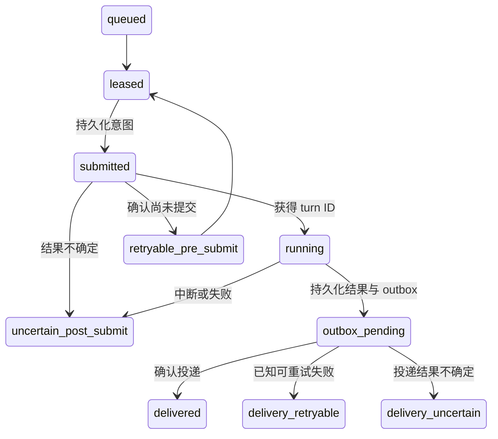

# 核心机制与取舍

中文 | [English](../docs_en/MECHANISMS.md)

## 1. 将“不确定”作为持久状态

远端模型 turn 可能已经开始，而调用方丢失了响应。盲目重试可能重复昂贵或改变状态的工作。worker 在写入 app-server **之前**先持久化 `submitted` 意图；只有传输层确认尚未提交的 `PreSubmitError` 才允许自动重试。越过这一边界的其他失败进入 `uncertain_post_submit`，等待明确的 reconciliation。

图中概括的是主要路径，并非完整的状态转换校验器。请结合 [`Router.process`](../internal/router/router.go) 和 [`Store.Recover`](../internal/store/store.go) 阅读：恢复过程区分遗留的本地租约、已提交／运行中的 turn，以及投递中的消息。保守处理不确定性的代价是人工核对和阻塞该 alias 的后续任务。这里**不声称端到端 exactly-once**。

对应测试：`TestCertifiedPreSubmitCanRetry`、`TestUncertainNeverResubmits`、`TestRecoveryBoundaries`、`TestCrashDuringDeliveryBecomesUncertain`。

## 2. 队列维护会话顺序

[`Store.Acquire`](../internal/store/store.go) 使用 immediate transaction。以下任一条件存在时都不能领取任务：该 alias 有未到期的外部租约；已有 leased／submitted／running 任务；前序任务尚未 delivered 或 dead-lettered。不同 alias 可以分别推进。

owner 与 endpoint 检查发生在入队之前。事件 digest 是持久去重键，与投递 ACK 是不同的概念，不能单独解决远端投递歧义。

对应测试：`TestDuplicateEventAndFIFO`、`TestDifferentAliasesCanAcquire`、`TestAcceptRequiresDurableAccountOwnerBinding`、`TestExternalGUIRacePolicy`。外部租约测试证明本地领取行为，不证明能够全局排他地控制上游所有原生客户端；通知可见性和租约到期仍是明确的集成前提。

## 3. 模型完成与消息投递分开处理

完成时，通过事务一并保存结果和待投递工作。平台投递失败不要求重新调用模型。outbox 区分确认成功、可重试失败与投递不确定；恢复时将 `sending` 视为不确定。终态处理清除保留的 payload／media 元数据，同时保留必要的去重证据。

对应证据：[store 测试](../internal/store/store_test.go)中的 `TestOutboxLifecycleAndScrub`，以及 [router 测试](../internal/router/router_test.go)中的 `TestDeliveryUncertainIsNotRetried`。

## 4. Canonical 身份有自己的时间线

记忆提取需要知道某个时间范围内哪个 thread 是 main。根据标题或当前选中的 thread 猜测，会丢失过去的 generation。store 在修改 alias 的同一事务内追加 generation 对应的 epoch。回滚产生新的已提交 generation，而不抹掉历史。

升级缺少历史时间戳的旧数据库时，迁移写入的是**观察基线**，不伪造旧 main 最初创建的时刻。需要未知早期覆盖范围的查询会失败。只读 socket 协议向 MQElite 返回 epoch 和覆盖来源，不授予数据库写入或控制能力。

对应证据：[main history 测试](../internal/store/main_history_test.go)：`TestSchemaFourMigrationCreatesHonestBaseline`、`TestEpochAppendFailureRollsBackAliasCAS`、`TestMainEpochHistoryInitializationRotationRollback`、`TestMainEpochHistoryCorruptionFailsClosed`。

## 5. 活动提示不决定任务状态

typing 或 processing reaction 只表示已认证输入被接受且尚未终止，不证明模型正在推进。创建 reaction 也有崩溃窗口：远端创建成功可能早于本地持久化。manager 先记录意图，再通过列举自己的 reaction 进行核对。清理采用有界重试和保留时间；平台长期不可用时可能留下远端孤立提示，这比无限期保存私人定位信息更符合该系统的取舍。

对应证据：[activity 测试](../internal/activity/activity_test.go)，特别是 `TestFeishuCreatingCrashWindowUsesListBeforeCleanup`、`TestFeishuDeleteFailureBacksOffWithoutStorm`、`TestCleanupRetentionBoundsLocalLocatorLifetime`。

## 6. 保持关联与输入边界明确

correlator 只接受目标 thread **及** turn 的最终 agent 文本，避免把别的对话内容当作回复。规范化逻辑将过长消息整体替换成提示，而不是静默截断一条指令；它检查 owner／persona／platform 身份，但平台层认证必须已经由未提取的适配器完成。

真实 Codex 传输还处理失败 turn 的状态与连接状态。这个小型 correlator 单独并不构成完整协议客户端或成功验证器。对应证据：[correlation 测试](../internal/appserver/correlation_test.go)和 [adapters 测试](../internal/adapters/adapters_test.go)。
