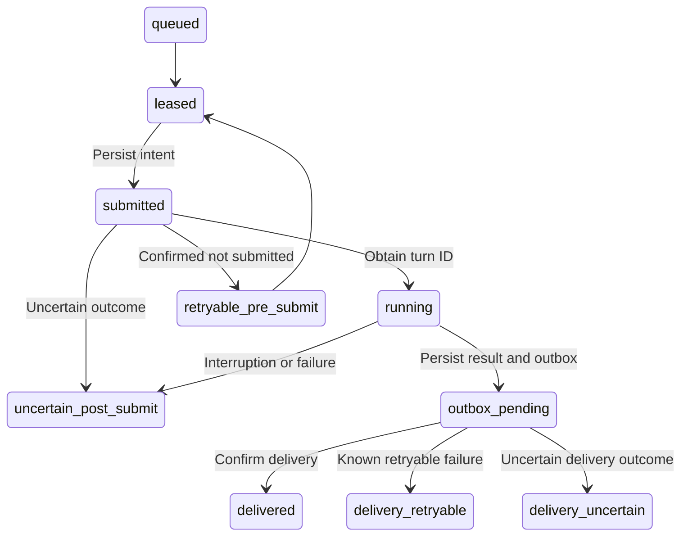

# Core Mechanisms and Trade-offs

[中文](../docs/MECHANISMS.md) | [English overview](../README_en.md)

## 1. Persist Uncertainty as a State

A remote model turn may have started even though the caller lost the response. Blind retries can duplicate expensive or state-changing work. The worker persists its `submitted` intent **before** writing to app-server; automatic retries are allowed only for a `PreSubmitError` that the transport certifies occurred before submission. Other failures beyond that boundary enter `uncertain_post_submit` and await explicit reconciliation.

The diagram summarizes the main paths; it is not a complete state-transition validator. Read it alongside [`Router.process`](../internal/router/router.go) and [`Store.Recover`](../internal/store/store.go): recovery distinguishes leftover local leases, submitted/running turns, and messages in delivery. Conservative handling of uncertainty costs manual reconciliation and blocks subsequent tasks for that alias. **This is not a claim of end-to-end exactly-once behavior.**

Corresponding tests: `TestCertifiedPreSubmitCanRetry`, `TestUncertainNeverResubmits`, `TestRecoveryBoundaries`, and `TestCrashDuringDeliveryBecomesUncertain`.

## 2. Preserve Session Order in the Queue

[`Store.Acquire`](../internal/store/store.go) uses an immediate transaction. A task cannot be acquired if any of the following holds: the alias has an unexpired external lease; a task is already leased/submitted/running; or an earlier task has not yet been delivered or dead-lettered. Different aliases can progress independently.

Owner and endpoint checks precede enqueueing. The event digest is a durable deduplication key, distinct from a delivery ACK; it cannot resolve remote delivery ambiguity on its own.

Corresponding tests: `TestDuplicateEventAndFIFO`, `TestDifferentAliasesCanAcquire`, `TestAcceptRequiresDurableAccountOwnerBinding`, and `TestExternalGUIRacePolicy`. External-lease tests establish local acquisition behavior, not globally exclusive control over every upstream native client; notification visibility and lease expiry remain explicit integration assumptions.

## 3. Separate Model Completion from Message Delivery

On completion, a transaction stores both the result and pending delivery work. A platform delivery failure does not require invoking the model again. The outbox distinguishes confirmed success, retryable failure, and uncertain delivery; recovery treats `sending` as uncertain. Terminal-state handling clears retained payload/media metadata while preserving the necessary deduplication evidence.

Evidence: `TestOutboxLifecycleAndScrub` in the [store tests](../internal/store/store_test.go), and `TestDeliveryUncertainIsNotRetried` in the [router tests](../internal/router/router_test.go).

## 4. Canonical Identity Has Its Own Timeline

Memory extraction needs to know which thread was main during a given time range. Guessing from titles or the currently selected thread loses past generations. In the same transaction that changes the alias, the store appends the epoch for the generation. A rollback produces a new committed generation rather than erasing history.

When upgrading an old database that lacks historical timestamps, migration writes an **observation baseline**, not a fabricated original creation time for the old main. Queries that require unknown earlier coverage fail. The read-only socket protocol returns epochs and coverage provenance to MQElite without granting database-write or control capabilities.

Evidence in the [main-history tests](../internal/store/main_history_test.go): `TestSchemaFourMigrationCreatesHonestBaseline`, `TestEpochAppendFailureRollsBackAliasCAS`, `TestMainEpochHistoryInitializationRotationRollback`, and `TestMainEpochHistoryCorruptionFailsClosed`.

## 5. Activity Indicators Do Not Determine Task State

Typing indicators or processing reactions only indicate that authenticated input has been accepted and has not terminated; they do not prove that the model is making progress. Reaction creation also has a crash window: remote creation can succeed before local persistence. The manager records intent first, then reconciles by listing its own reactions. Cleanup uses bounded retries and retention periods; prolonged platform unavailability can leave orphaned remote indicators. For this system, that trade-off is preferable to retaining private locator information indefinitely.

Evidence: the [activity tests](../internal/activity/activity_test.go), especially `TestFeishuCreatingCrashWindowUsesListBeforeCleanup`, `TestFeishuDeleteFailureBacksOffWithoutStorm`, and `TestCleanupRetentionBoundsLocalLocatorLifetime`.

## 6. Keep Correlation and Input Boundaries Explicit

The correlator accepts final agent text only for the target thread **and** turn, preventing content from another conversation from being mistaken for the reply. Normalization replaces an oversized message in full with a notice instead of silently truncating an instruction. It checks owner/persona/platform identity, but platform-level authentication must already have been performed by the adapters omitted from this extraction.

The real Codex transport also handles failed-turn status and connection state. This small correlator alone is neither a complete protocol client nor a success validator. Evidence: the [correlation tests](../internal/appserver/correlation_test.go) and [adapter tests](../internal/adapters/adapters_test.go).
